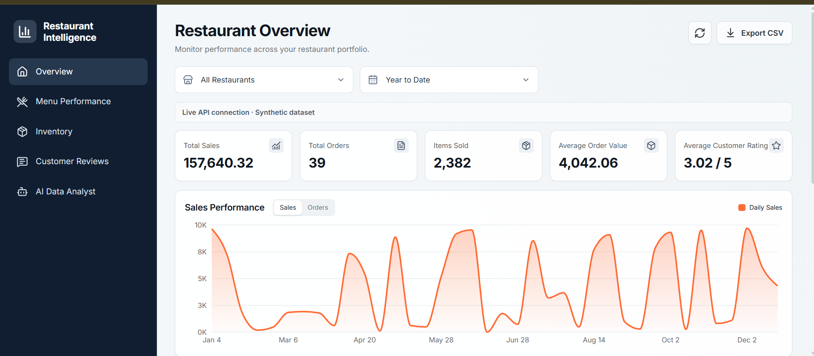
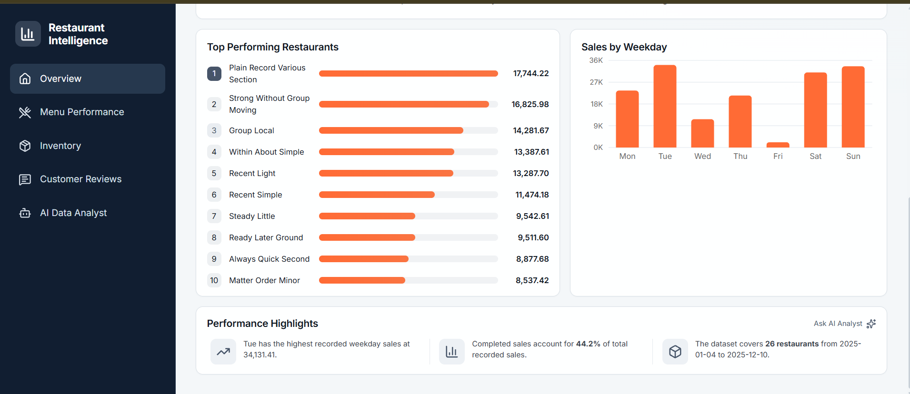
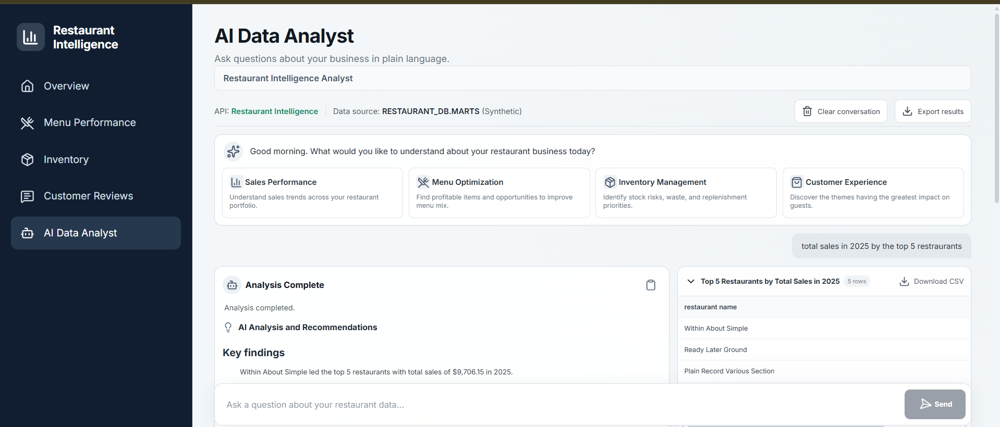
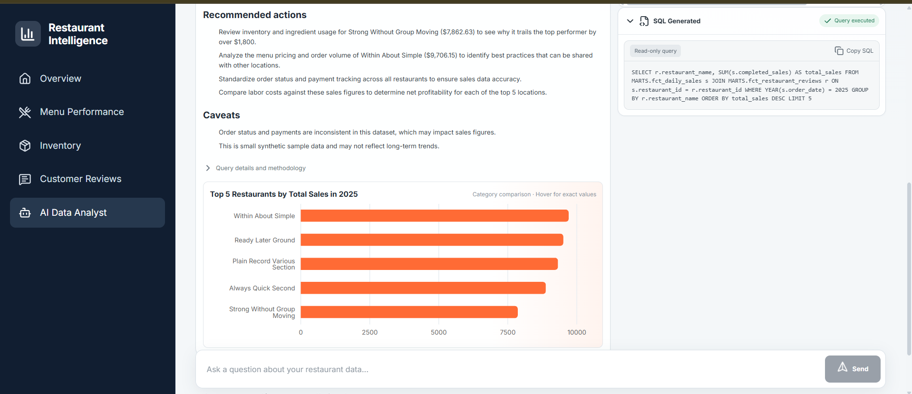

# Restaurant Intelligence Platform

An end-to-end analytics project on **synthetic restaurant data**. Raw tables in Snowflake are cleaned and summarised with dbt, served by a FastAPI backend, and explored in a React dashboard with an AI data analyst powered by Google Gemini. The original Streamlit dashboard is kept as well.

> **All data is synthetic sample data** (small, uniform tables with some deliberate quirks). Treat every number as a demo, not as real business performance.

## Architecture

```
33 CSV files -> Snowflake RESTAURANT_DB.PUBLIC (raw tables)
             -> dbt staging views (STAGING, 33 models)
             -> dbt mart tables   (MARTS, 4 models)
                     |
                     v
React (Vite, TypeScript) -> FastAPI -> Snowflake (read-only role, MARTS only)
                                    -> Google Gemini (SQL and business insights)
```

The browser never talks to Snowflake or Gemini directly. All credentials live in environment variables on the backend and never appear in frontend code. During development, Vite forwards `/api` requests to FastAPI.

## Features

- **Overview:** KPIs, daily sales with a previous-period comparison, weekday sales, and top restaurants.
- **Menu Performance:** category and item revenue, sortable and searchable table, CSV export.
- **Inventory:** stock by ingredient and restaurant with low-stock highlighting.
- **Customer Reviews:** ratings by restaurant, best rated and needs attention.
- **AI Data Analyst:** ask a question in plain English. Gemini writes a SQL query, the backend validates and runs it on the marts, and Gemini summarises the result as key findings, recommended actions and caveats.

## Screenshots

**Overview**




**AI Data Analyst**




*The Overview totals use sales for every order that is not cancelled. The AI Analyst example ranks restaurants by completed sales only, so the two rankings differ. All data is synthetic.*

## Data model

| Mart | One row is | Answers |
|---|---|---|
| `fct_daily_sales` | one restaurant on one day | How much does each restaurant sell per day? |
| `fct_menu_item_performance` | one menu item | Which dishes sell best? |
| `fct_inventory` | one stock record | What is in stock at each restaurant? |
| `fct_restaurant_reviews` | one restaurant | How is each restaurant rated? |

Personal data (emails, phones, customer names, review comments) is deliberately left out of the marts.

**Revenue definitions.** `completed_sales` counts completed orders only. `sales_all_open_and_completed` counts every order that is not cancelled, including pending and active ones. Use matching pairs of sales and order counts when computing averages.

## Data quality

dbt runs 77 tests (`unique` and `not_null` on every ID, plus accepted values for order status). The synthetic data has known quirks, for example cancelled orders that have payments, which is why order status is used as the revenue signal.

## Security notes

- The API connects to Snowflake with a dedicated read-only role that can `SELECT` from the `MARTS` schema only (`RESTAURANT_API_ROLE`).
- AI-generated SQL passes a safety check before it runs: a single `SELECT` statement, mart tables only, a row cap and a timeout. This is a guard, not a perfect lock, so the read-only role is the real protection.
- Free-tier Gemini content may be used by Google to improve its products, so only synthetic or non-personal data should be sent to it.
- Secrets are never committed. `profiles.yml`, `.env` and key files are in `.gitignore`.

## Run it locally

You need a Snowflake account with the tables loaded and the dbt models built, plus Python 3.12 or newer and Node.js.

**1. Python environment and dbt**
```powershell
python -m venv .venv
.\.venv\Scripts\Activate.ps1
python -m pip install -r requirements.txt
```
Copy `profiles.yml.example` to `profiles.yml` and fill in your Snowflake account and user. Never commit `profiles.yml`.

**2. Credentials (per terminal session, never stored in files)**
```powershell
$env:DBT_PROFILES_DIR = "."
$env:SNOWFLAKE_ACCOUNT = '<account-id>'
$env:SNOWFLAKE_USER = '<username>'
$env:SNOWFLAKE_PASSWORD = '<password>'
$env:GEMINI_API_KEY = '<gemini-api-key>'
```

**3. Build and test the data models**
```powershell
dbt debug
dbt run
dbt test
```

**4. Start the backend (port 8000)**
```powershell
python -m pip install -r backend\requirements.txt
python -m uvicorn app.main:app --reload --app-dir backend --port 8000
```
Check `http://127.0.0.1:8000/api/health` and `http://127.0.0.1:8000/docs`. The first Snowflake request can take about 10 seconds because of the login. After that the connection is reused. The API logs in with the role `RESTAURANT_API_ROLE` by default. Set `SNOWFLAKE_ROLE` to use another one.

**5. Start the frontend (port 5173)**
```powershell
cd frontend
npm install
npm run dev
```
Open `http://localhost:5173`.

**Optional: the original Streamlit dashboard**
```powershell
python -m streamlit run dashboard\app.py
```

## Tech stack

Snowflake, dbt Core, Python, FastAPI, Pydantic, Snowflake Python Connector, React, TypeScript, Vite, Tailwind CSS, Recharts, Lucide, Streamlit, Google Gemini API. The interface design was created in Figma Make and ported into the React project.

## Project notes

See `PROJECT_STATUS.md` for the project history, decisions and open items.

## License

MIT. See `LICENSE`.